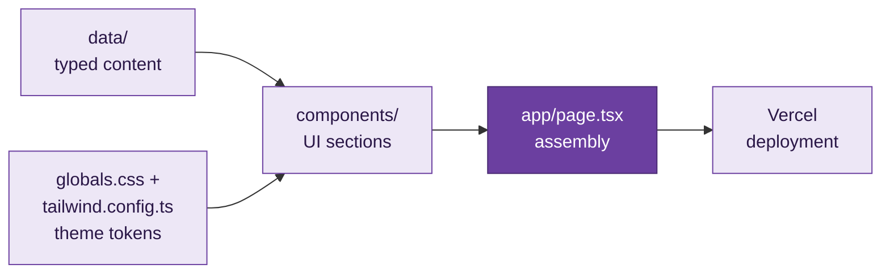

<p align="center">
  
</p>

<p align="center"><i>Personal portfolio for full-stack software engineering and AI agent work.</i></p>

<p align="center">
  <a href="https://eman-fatima-portfolio-psi.vercel.app"></a>
</p>

<p align="center">
  
  
  
  
  
</p>

---

## 💜 What is this?

This is the personal portfolio of **Eman Fatima**, a Software Engineering student at FAST NUCES Lahore who builds full-stack web applications and AI agents.

It is designed to feel less like a static page and more like a live, engineered interface: a terminal-style hero, a code-editor style About card, a command palette, and motion that responds to the visitor.

| Section | What it shows |
|---|---|
| 🧑‍💻 `Hero` | Terminal window with animated project and stack output |
| 📖 `About` | Bio and quick facts |
| 🛠️ `Skills` | Grouped skills and a tech marquee |
| 🚀 `Projects` | Featured work with GitHub links |
| 🧭 `Experience` | Animated timeline |
| 🎓 `Education` | Degree, honors, and achievements |
| 📫 `Contact` | Copy-email, resume download, and social links |

---

## ✨ Highlights

- **Terminal-style hero:** animated `whoami`, stack, and project output.
- **Command palette:** press `Ctrl+K` / `Cmd+K` to jump to sections, copy email, or download the resume.
- **Light and dark mode:** preference is persisted between visits.
- **Alive interface:** cursor spotlight, project card tilt, scroll progress bar, motion reveals, and a self-drawing timeline.
- **Responsive:** mobile navigation with active-section highlighting.
- **Accessible:** semantic HTML, visible focus states, and full reduced-motion support for visitors who prefer less animation.
- **Content stays clean:** all text lives in typed files under `data/`, so components never hardcode content.

---

## 🚀 Featured Projects

| Project | Type | Description |
|---|---|---|
| [Signalwise](https://github.com/l253010/whatsapp-notification-router-agent) | HackerRank Orchestrate hackathon · Individual | AI-powered WhatsApp notification router that decides whether messages should notify, digest, or mute. |
| [AuctionSystem](https://github.com/l253010/OOP-Project-SEMESTER-2) | OOP semester project · Team | Desktop auction software with English and Dutch auctions, wallets, roles, and SQLite. |
| [Pac-Dora: Star Catcher](https://github.com/l253010/Pacman-game) | Programming Fundamentals semester project · Team | A C++ and SFML Pac-Man-style game with collision detection, tile maps, and BFS enemy AI. |
| [Digital Logics Studio](https://github.com/l253010/DigitalLogicsStudio) | QuantumLogics internship · Team | React platform for learning and simulating digital logic design, including an interactive trainer board. |

---

## 🧭 How It Works



1. **Content:** every fact (name, role, links, skills, projects, experience, education) is defined once in `data/` with exported TypeScript interfaces.
2. **Theme:** colors, glows, gradients, and fonts are Tailwind tokens and CSS variables, so no random hex values live inside components.
3. **Components:** each section reads only from `data/` and renders its own part of the page.
4. **Assembly:** `app/page.tsx` stacks the sections in order, with the navbar, command palette, and footer around them.
5. **Deploy:** pushing to GitHub triggers an automatic Vercel build.

---

## 🛠️ Tech Stack

| Layer | Tools |
|---|---|
| Framework | Next.js 14 App Router |
| Language | TypeScript (strict) |
| Styling | Tailwind CSS v3 and CSS variables |
| Motion | Framer Motion |
| Icons | lucide-react and inline SVG for brand icons |
| Fonts | Space Grotesk, Inter, and JetBrains Mono through `next/font` |
| Hosting | Vercel |

---

## 🗂️ Repository Layout

```text
.
├── docs/                  # Reference files: requirements, design system, content
│   ├── requirements.md
│   ├── design.md
│   └── content.md
├── public/                # Static assets
│   ├── resume.pdf
│   ├── profile image
│   └── favicon.ico
├── data/                  # All portfolio content, typed
│   ├── site.ts            # Name, role, email, social links
│   ├── skills.ts
│   ├── projects.ts
│   ├── experience.ts
│   └── education.ts
├── components/            # NavBar, Hero, About, Skills, Projects,
│                          # Experience, Education, Contact, Footer
├── app/
│   ├── layout.tsx         # Fonts, metadata, providers
│   ├── page.tsx           # Assembles all sections
│   └── globals.css        # Tailwind layers and design tokens
├── tailwind.config.ts
├── tsconfig.json
└── package.json
```

---

## 🚀 Running Locally

**Requirements**

- Node.js 18.17 or newer
- npm

**Install and run**

```bash
npm install
npm run dev
```

Open [http://localhost:3000](http://localhost:3000).

---

## ✅ Checks

```bash
npm run typecheck
npm run lint
```

The project targets Next.js 14. If lint reports an ESLint major-version compatibility error, install the Next.js 14-compatible release:

```bash
npm install --save-dev eslint@8.57.1
```

To verify the production bundle before deploying:

```bash
npm run build
```

---

## ✏️ Editing Content

Everything lives in typed files under [`data/`](./data):

- [`data/site.ts`](./data/site.ts): title, description, name, role, email, and social links
- [`data/skills.ts`](./data/skills.ts): skill groups and marquee items
- [`data/projects.ts`](./data/projects.ts): project descriptions, tags, technologies, and repositories
- [`data/experience.ts`](./data/experience.ts): experience entries
- [`data/education.ts`](./data/education.ts): degree, CGPA, honors, activities, and achievements

To update the resume, replace `public/resume.pdf` with the new PDF. The Download Resume buttons link to `/resume.pdf`, so no component change is needed.

---

## ☁️ Deploying to Vercel

1. Push the repository to GitHub:

   ```bash
   git add .
   git commit -m "Update portfolio"
   git push origin main
   ```

2. Open [vercel.com](https://vercel.com) and sign in with GitHub.
3. Select **Add New → Project** and import `l253010/eman-fatima-portfolio`.
4. Keep the detected **Next.js** framework settings and click **Deploy**.

No environment variables are required. Every push to `main` redeploys automatically.

🔗 **Live site:** [eman-fatima-portfolio-psi.vercel.app](https://eman-fatima-portfolio-psi.vercel.app)

A custom domain can be connected from **Vercel → Project → Settings → Domains**.

---

<p align="center">
  
</p>

<p align="center"><i>💜 Built by <a href="https://github.com/l253010">Eman Fatima</a> with Next.js, Tailwind, and too much coffee.</i></p>
